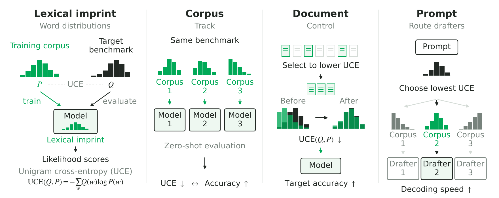

<h1 align="center">The Lexical Imprint of Pre-training Data</h1>

<p align="center">
  <a href="https://openreview.net/forum?id=8hN2Bcw0x2"></a>
  <a href="https://neurips.cc/virtual/2026/loc/sydney/poster/155069"></a>
  <a href="https://arxiv.org/abs/2602.10657"></a>
  <a href="LICENSE"></a>
</p>

<p align="center">
  Jeonghoon Kim<sup>1,2*</sup> · Woojin Chung<sup>2*</sup> · Woomin Song<sup>2</sup> · Cheonbok Park<sup>1,2</sup> · Nako Sung<sup>1</sup> · Jinwoo Shin<sup>2</sup><br>
  <sup>1</sup>NAVER Cloud &nbsp;&nbsp; <sup>2</sup>KAIST &nbsp;&nbsp; <sup>*</sup>Equal contribution
</p>

<p align="center">
  
</p>

This repository contains the code for the NeurIPS 2026 paper **The Lexical Imprint of Pre-training Data**.

Word-level unigram cross-entropy (UCE) measures how closely the word distribution of a reference corpus matches that of a target benchmark. In controlled from-scratch pre-training on four corpora at three model scales, lower UCE goes with higher zero-shot accuracy on every benchmark we test. Selecting training documents that lower UCE against a target (the UCE-filter) raises accuracy on that target above random and DSIR selections at the same token budget. Routing each prompt to the drafter whose training corpus has the lowest UCE against it raises speculative-decoding throughput.

The code here is the package submitted with the paper: the UCE metric, the UCE-filter, our DSIR baseline, and benchmark preprocessing.

## Contents

| Path | What it does | Paper |
|---|---|---|
| [`unigram_ce/`](unigram_ce) | Word-level unigram cross-entropy between a pre-training corpus and a benchmark | §3, §4 |
| [`ce_filter/`](ce_filter) | UCE-filter (named CE-filter in the code): analytic row-local ΔH scoring and top-*p*% selection | §5.1, §5.2 |
| [`dsir/`](dsir) | DSIR baseline (Xie et al., 2023) with hashed unigram and bigram features and optional Gumbel top-K | §5.2 |
| [`benchmarks/`](benchmarks) | Download and preprocessing of the 11 evaluation benchmarks | §4.1, §5.2 |

Each directory has its own `README.md` with the full set of options.

## Installation

```bash
git clone https://github.com/penpaperkeycode/lexical-imprint.git
cd lexical-imprint
pip install -r requirements.txt   # Python >= 3.9
```

## Quick start

```bash
# 1. Download and preprocess the 11 benchmarks
python benchmarks/preprocess_csr7.py --output_dir /data/benchmarks/

# 2. UCE between a pre-training corpus and one benchmark (in bits)
python unigram_ce/compute_unigram_ce.py \
    --bench_path /data/benchmarks/arc_easy/arc_easy.parquet \
    --train_path /data/cc_dump/ \
    --train_col text \
    --n_workers 64 --bits

# 3. UCE-filter: keep the 20% of rows most aligned with the targeted benchmarks
python ce_filter/ce_filter.py \
    --bench_path /data/benchmarks/benchmark_group_en/ \
    --train_path /data/cc_dump/ \
    --train_format parquet \
    --top_pct 20 \
    --out_parquet /data/filtered_top20/ \
    --n_workers 120

# 4. DSIR baseline through the single-machine API
python -c "
from dsir.dsir import select_topk_indices
import pyarrow.parquet as pq
src = pq.read_table('/data/cc_dump/part-00000.parquet')['text'].to_pylist()
tgt = pq.read_table('/data/benchmarks/benchmark_group_en/arc_easy.parquet')['text'].to_pylist()
idx = select_topk_indices(src, tgt, k=100_000, bucket_count=10_000)
print(f'Selected {len(idx)} indices')
"
```

A small end-to-end DSIR demo that needs no real corpus runs in about 30 seconds:

```bash
bash dsir/examples/tiny_demo/run.sh
```

For multi-pod (Kubernetes) runs of the DSIR pipeline, see `dsir/scripts/run_dsir_select_k8s.sh` and `dsir/docs/multi_pod_orchestration.md`.

## Method summary

**UCE.** For a target benchmark with word distribution *Q* and a reference corpus with word distribution *P*,

    UCE(Q, P) = - sum_{w in V_b} Q(w) log P(w) = H(Q) + KL(Q || P),

where *V_b* is the benchmark vocabulary. Corpus counts of benchmark words that never occur in the corpus are floored at one. Words come from NFKC normalization, punctuation stripping, and whitespace splitting, without lowercasing, as in the paper. The UCE script and the UCE-filter share this tokenizer, and `--lowercase` in `unigram_ce/compute_unigram_ce.py` lowercases words first (a preprocessing ablation in the paper's appendix).

**UCE-filter.** For each training row *r*, the change in UCE from removing *r* has a closed form that depends only on the words in *r*, so all rows can be scored in one linear pass and the top *p*% kept. On our setup, scoring more than 100B tokens takes about 6 hours on a single 120-core machine.

**DSIR baseline.** A reimplementation of Xie et al. (NeurIPS 2023) with `mmh3` hashing into 10,000 buckets and log importance weights log(P_t / P_s). Two variants are exposed: the paper's sum-based score with Gumbel top-K (`--gumbel_seed 42`), and a length-normalized ablation with deterministic top-K.

**Benchmarks.** `benchmarks/preprocess_csr7.py` downloads the 11 benchmarks from the Hugging Face Hub and writes one parquet per benchmark plus a combined `benchmark_group_en/` directory. The targeted group (CSR7) is ARC-Easy, ARC-Challenge, HellaSwag, SciQ, OpenBookQA, PIQA, and SWAG. The out-of-target group is LAMBADA, CommonsenseQA, BoolQ, and Social IQA. Each row's text concatenates the question or context with all answer choices.

## Reproducing the selection experiments

The paper compares four selections from the same source corpus (DCLM or FineWeb-Edu): a row-count-matched random sample, DSIR, the DSIR length-normalized ablation, and the UCE-filter. Each produces a 70B-token subset, tokenized with the GPT-2 tokenizer, on which 1.34B and 3.33B models (DataComp-LM architecture patterns, counting the tied embedding) are trained from scratch under one recipe and evaluated zero-shot with lm-evaluation-harness. The training loop is not part of this repository. The paper's appendix lists the full training and evaluation configuration.

Not included here: the inference-time routing study (§6), the BETR baseline, and the 30B Stage-2 case study.

## Implementation notes

- **DSIR top-K truncation.** The multi-pod implementation keeps a per-pod top-K heap before applying Gumbel noise. At our scale (per-pod K ≈ 1.26 × 10⁸) the score gap between the heap cutoff and the global cutoff is about 12K log units, far above the Gumbel(0, 1) noise scale, so the result is close to deterministic top-K. See `dsir/docs/algorithm.md`.
- **K calibration.** We grow K until the selected token count reaches the 70B target. See `dsir/docs/reproducibility.md`.
- **Length bias of sum-based DSIR.** When the mean log-importance ratio is negative, as it usually is for benchmark-versus-web alignment, a sum-based score favors short documents. The length-normalized ablation removes this bias.

## Changes from the submitted package

The code matches the supplementary package submitted to OpenReview, with one exception. `unigram_ce/compute_unigram_ce.py` lowercased words in the submitted version, while the paper's numbers use case-preserving words. It now preserves case by default and keeps the old behavior behind `--lowercase`. Author names replace the anonymous placeholders in the license files.

## Citation

```bibtex
@inproceedings{kim2026lexical,
  title     = {The Lexical Imprint of Pre-training Data},
  author    = {Kim, Jeonghoon and Chung, Woojin and Song, Woomin and Park, Cheonbok and Sung, Nako and Shin, Jinwoo},
  booktitle = {Advances in Neural Information Processing Systems},
  year      = {2026}
}
```

## License

MIT. See [`LICENSE`](LICENSE).
